<h2>TensorFlow-FlexUNet-Image-Segmentation-IQ-OTHNCCD-Lung-Cancer-CT (2026/11/08)</h2>
<h3>IQ-OTHNCCD-Lung-Cancer-CT: AI Generated Pseudo Masks Segmentation Challenge</h3>
Sarah T. Arai 
Software Laboratory antillia.com  
This is the first experiment of Image Segmentation for <b>IQ-OTHNCCD-Lung-Cancer-CT </b>
 based on
our <a href="https://github.com/sarah-antillia/TensorFlow-FlexUNet-Image-Segmentation-Model">TensorFlowFlexUNet Model</a>
 (<b>TensorFlow Flexible UNet Image Segmentation Model for Multiclass</b>) and a PNG
 <a href="https://drive.google.com/file/d/1v_XNWJ4KRTpJpCsx4eSspUdOu74xpRq7/view?usp=sharing">
Augmengted-IQ-OTHNCCD-Lung-Cancer-CT-ImageMask-Dataset.zip</a> 
(<a href="https://creativecommons.org/publicdomain/zero/1.0/">CC0: Public Domain</a>)
which was derived by us from the Kaggle  
  
<a href="https://www.kaggle.com/datasets/hamdallak/the-iqothnccd-lung-cancer-dataset">
<b>The IQ-OTH/NCCD lung cancer dataset</b>
</a> by Hamdalla F. Al-Yasriy.
  

<b>Actual Image Segmentation for IQ-OTHNCCD-Lung-Cancer-CT Images of 512x512 pixels</b> 
As shown below, the inferred masks resemble the ground-truth masks except for the second case.  
 
<table>
<tr>
<th width="320" height="auto">Input: image</th>
<th width="320" height="auto">Mask (ground_truth)</th>
<th width="320" height="auto">Prediction: inferred_mask</th>
</tr>
<tr>
<td></td>
<td></td>
<td></td>
</tr>
<tr>
<td></td>
<td></td>
<td></td>
</tr>
<tr>
<td></td>
<td></td>
<td></td>
</tr>
</table>

 
<h3>1. Dataset Citation</h3>
The dataset used here was derived from the following Kaggle:  

<a href="https://www.kaggle.com/datasets/hamdallak/the-iqothnccd-lung-cancer-dataset">
<b>The IQ-OTH/NCCD lung cancer dataset</b>
</a> 
 
<b>Lung Cancer CT Scans from Iraqi hospitals: Normal, Benign, and Malignant Cases
</b> 
by Hamdalla F. Al-Yasriy.
  
The following explanation was taken the website above.
  
<b>About Dataset</b> 
The Iraq-Oncology Teaching Hospital/National Center for Cancer Diseases (IQ-OTH/NCCD) lung cancer dataset was collected in the above-mentioned specialist hospitals over a period of three months in fall 2019. It includes CT scans of patients diagnosed with lung cancer in different stages, as well as healthy subjects. IQ-OTH/NCCD slides were marked by oncologists and radiologists in these two centers. The dataset contains a total of 1190 images representing CT scan slices of 110 cases. These cases are grouped into three classes: normal, benign, and malignant. of these, 40 cases are diagnosed as malignant; 15 cases diagnosed with benign; and 55 cases classified as normal cases. The CT scans were originally collected in DICOM format. The scanner used is SOMATOM from Siemens. CT protocol includes: 120 kV, slice thickness of 1 mm, with window width ranging from 350 to 1200 HU and window center from 50 to 600 were used for reading. with breath hold at full inspiration. All images were de-identified before performing analysis. Written consent was waived by the oversight review board. The study was approved by the institutional review board of participating medical centers. Each scan contains several slices. The number of these slices range from 80 to 200 slices, each of them represents an image of the human chest with different sides and angles. The 110 cases vary in gender, age, educational attainment, area of residence and living status. Some of them are employees of the Iraqi ministries of Transport and Oil, others are farmers and gainers. Most of them come from places in the middle region of Iraq, particularly, the provinces of Baghdad, Wasit, Diyala, Salahuddin, and Babylon.
  
<b>Citations</b> 
1- Diagnosis of lung cancer based on CT scans using CNN 
can be cited as : 
(H. F. Al-Yasriy, M. S. Al-Husieny, F. Y. Mohsen, E. A. Khalil, and Z. S. Hassan,  
"Diagnosis of Lung Cancer Based on CT Scans Using CNN,"  
IOP Conference Series: Materials Science and Engineering, vol. 928, 2020.) 
 
2- Evaluation of SVM performance in the detection of lung cancer in marked CT scan dataset
can be cited as: 
(H. F. Kareem, M. S. A.-Husieny, F. Y. Mohsen, E. A. Khalil, and Z. S. Hassan,  
“Evaluation of SVM performance in the detection 
of lung cancer in marked CT scan dataset,” Indonesian Journal of Electrical Engineering  
and Computer Science, vol. 21, no. 3, 
pp. 1731-1738, 2021, doi: 10.11591/ijeecs.v21.i3.pp1731-1738.) 
 
3- The IQ-OTH/NCCD lung cancer dataset 
can be cited as : 
(alyasriy, hamdalla; AL-Huseiny, Muayed (2023), “The IQ-OTH/NCCD lung cancer dataset”,  
Mendeley Data, V4, doi: 10.17632/bhmdr45bh2.4) 
 
<b>License</b> 
<a href="https://creativecommons.org/publicdomain/zero/1.0/">CC0: Public Domain</a>
 
 
<h3>
2. IQ-OTHNCCD-Lung-Cancer-CT ImageMask Dataset
</h3>
<h3>2.1 Download ImageMask Dataset</h3>
 If you would like to train this IQ-OTHNCCD-Lung-Cancer-CT Segmentation model,
 please download the dataset from Google Drive  
 <a href="https://drive.google.com/file/d/1v_XNWJ4KRTpJpCsx4eSspUdOu74xpRq7/view?usp=sharing">
Augmented-IQ-OTHNCCD-Lung-Cancer-CT-ImageMask-Dataset.zip</a>. 
Expand the downloaded ImageMaskDataset and put it under the <b>./dataset</b> folder.
 
<pre>
./dataset
└─IQ-OTHNCCD-Lung-Cancer-CT
    ├─test
    │   ├─images
    │   └─masks
    ├─train
    │   ├─images
    │   └─masks
    └─valid
         ├─images
         └─masks
</pre>
 
<b>IQ-OTHNCCD-Lung-Cancer-CT Statistics</b> 
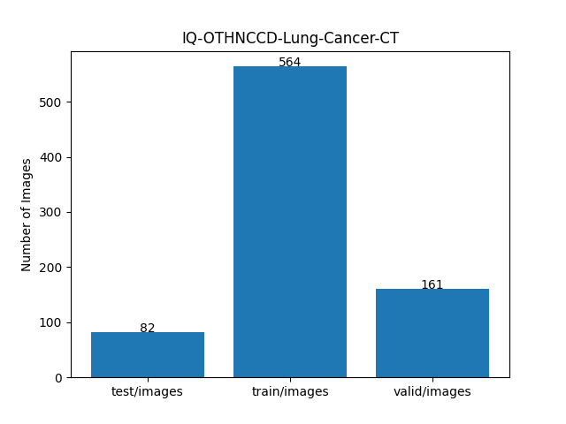 
 
As shown above, the number of images in the training and valid datasets is not enough to use for the
 training set of our segmentation model.
 
<h3>2.2 Derivation of ImageMask Dataset</h3>
The folder structure of the original IQ-OTHNCCD dataset is as follows, but it contains no
annotation (mask) files.
<pre>
└─The IQ-OTHNCCD lung cancer dataset
    ├─Benign cases
    ├─Malignant cases
    └─Normal cases
</pre>
<b>Step 1</b> 
We generated pseudo masks corresponding to the master images in <b>Malignant cases</b>
by applying a segmentation (inference) method of the pretrained model 
<a href="https://github.com/sarah-antillia/TensorFlow-FlexUNet-Image-Segmentation-Lung-Cancer-CT">
TensorFlow-FlexUNet-Image-Segmentation-Lung-Cancer-CT
</a> to the master images.
  
<b>Step 2</b> 
We generated an augmented ImageMask dataset from the pseudo masks and the master images 
by applying flipping augmentation tools to all pairs of the images and masks.
  
<b>Step 3</b> 
We generated a new pretrained FlexUNet segmentation model by using the augmented ImageMask 
dataset derived at Step 2.
  
<b>Step 4</b> 
We generated a new pseudo masks corresponding to the master images by applying a segmentation method of the new 
pretrained FlexUNet model obtained at Step 3.
  
<b>Step 5</b> 
We finally generated our own <b>Augmented-IQ-OTHNCCD-Lung-Cancer-CT-ImageMask-Dataset</b> from the new pseudo masks and the master images 
by applying flipping augmentation tools to all pairs of the images and masks.
  
<h3>2.3 Train Sample Images and Masks</h3>
<b>Train_sample_images</b> 
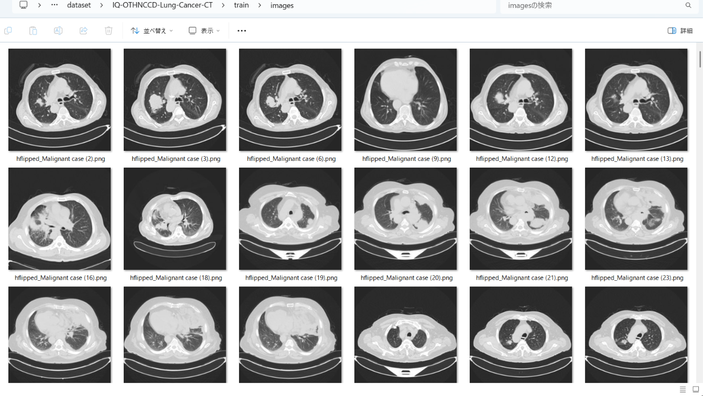
 
<b>Train_sample_masks</b> 
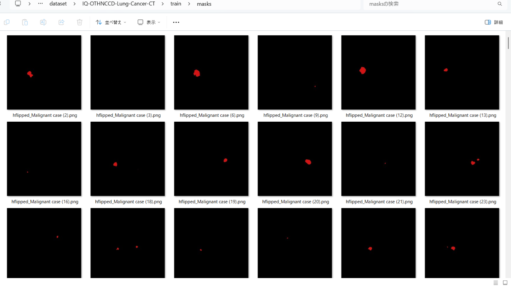
 
<h3>
3. Train TensorFlowFlexUNet Model
</h3>
 We trained the IQ-OTHNCCD-Lung-Cancer-CT TensorFlowFlexUNet model using the following
<a href="./projects/TensorFlowFlexUNet/IQ-OTHNCCD-Lung-Cancer-CT/train_eval_infer.config"> <b>train_eval_infer.config</b></a> file.  
Please move to ./projects/TensorFlowFlexUNet/IQ-OTHNCCD-Lung-Cancer-CT and run the following bat file. 
<pre>
>1.train.bat
</pre>
This runs the following command. 
<pre>
>python ../../../src/TensorFlowFlexUNetTrainer.py ./train_eval_infer.config
</pre>

<b>Model parameters</b> 
Defined a small <b>base_filters=16 </b> and large <b>base_kernels=(11,11)</b> for the first Conv Layer of Encoder Block of 
<a href="./src/TensorFlowFlexUNet.py">TensorFlowFlexUNet.py</a> 
and a large <b>num_layers=8</b> (including a bridge between Encoder and Decoder Blocks).
<pre>
[model]
; You may specify your own UNet class derived from our TensorFlowFlexModel
model         = "TensorFlowFlexUNet"
generator     =  False
image_width    = 512
image_height   = 512
image_channels = 3
num_classes    = 2
base_filters   = 16
base_kernels   = (11,11)
num_layers     = 8
dropout_rate   = 0.03
dilation       = (1,1)
</pre>
<b>Learning rate</b> 
Defined a small learning rate.  
<pre>
[model]
learning_rate  = 0.00007
</pre>
<b>Loss and metrics functions</b> 
Specified "categorical_focal_dice_loss" and <a href="./src/dice_coef_multiclass.py">"dice_coef_hybrid"</a>. 
<pre>
[model]
loss           = "categorical_focal_dice_loss"
metrics        = ["dice_coef_hybrid"]
hybrid_alpha   = 1.6
hybrid_beta    = 0.4
</pre>
<b>Dataset class</b> 
Specified <a href="./src/ImageCategorizedMaskDataset.py">ImageCategorizedMaskDataset</a> class. 
<pre>
[dataset]
class_name    = "ImageCategorizedMaskDataset"
</pre>
 
<b>Learning rate reducer callback</b> 
Enabled the learning_rate_reducer callback and a small reducer_patience.
<pre> 
[train]
learning_rate_reducer = True
reducer_factor     = 0.4
reducer_patience   = 4
</pre>
<b>Early stopping callback</b> 
Enabled early stopping callback with the patience parameter.
<pre>
[train]
patience      = 10
</pre>
<b>RGB Color map</b> 
Specified RGB color map dict for IQ-OTHNCCD-Lung-Cancer-CT 2 classes. 
<pre>
[mask]
mask_datatype= "categorized"
mask_file_format = ".png"
; IQ-OTHNCCD-Lung-Cancer-CT RGB color map dict for 1+1 classes.
;      Background: black,  Cancer:dark_red
rgb_map = {(0,0,0):0,(210,20,20):1,}
</pre>
<b>Epoch change inference callback</b> 
Enabled <a href="./src/EpochChangeInferencer.py">epoch_change_infer callback</a></b>. 
<pre>
[train]
epoch_change_infer       = True
epoch_change_infer_dir   =  "./epoch_change_infer"
num_infer_images         = 6
</pre>
By using this callback, on every epoch change, the inference procedure can be called
 for 6 images in the <b>mini_test</b> folder. This will help you confirm how the predicted mask changes 
 at each epoch during your training process.  
  
<!--
As shown below, early in the model training, the predicted masks from our FlexUNet segmentation model showed 
discouraging results.
 However, as training progressed through the epochs, the predictions gradually improved. 
   
 
-->
<b>Epoch_change_inference output at starting (epoch 1,2,3)</b> 
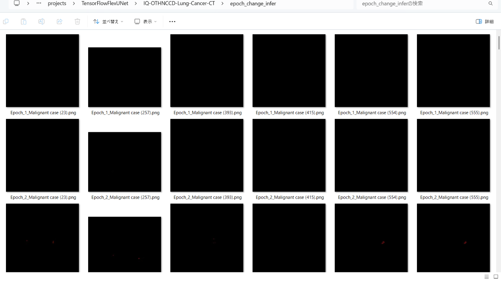 
 
<b>Epoch_change_inference output at middlepoint (epoch 22,23,24)</b> 
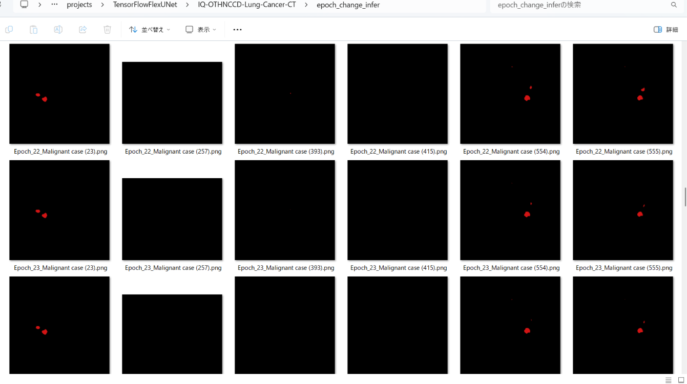 
 
<b>Epoch_change_inference output at ending (epoch 46,47,48)</b> 
 
 
In this experiment, the training process was stopped at epoch 48 by EarlyStoppingCallback. 
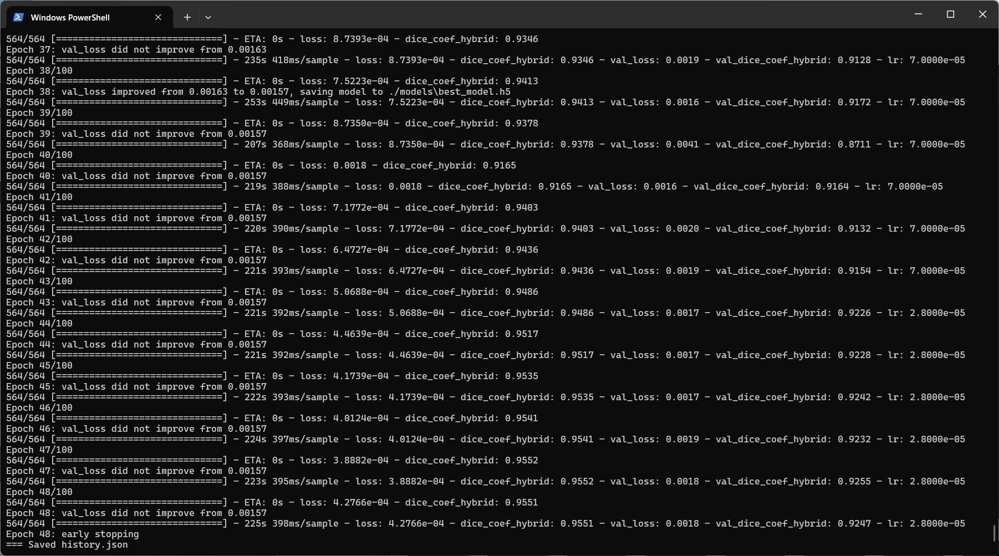 
 
<a href="./projects/TensorFlowFlexUNet/IQ-OTHNCCD-Lung-Cancer-CT/eval/train_metrics.csv">train_metrics.csv</a> 
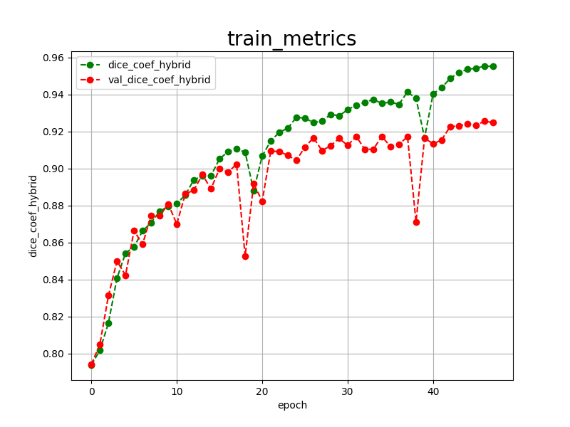 
 
<a href="./projects/TensorFlowFlexUNet/IQ-OTHNCCD-Lung-Cancer-CT/eval/train_losses.csv">train_losses.csv</a> 
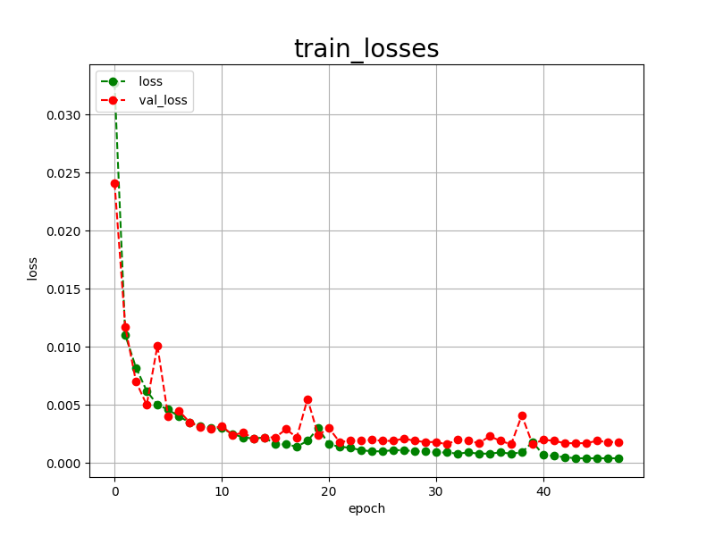 
 
<h3>
4. Evaluation
</h3>
Please move to <b>./projects/TensorFlowFlexUNet/IQ-OTHNCCD-Lung-Cancer-CT</b> folder,
and run the following bat file to evaluate the TensorFlowUNet model for IQ-OTHNCCD-Lung-Cancer-CT. 
<pre>
>./2.evaluate.bat
</pre>
This runs the following command.
<pre>
>python ../../../src/TensorFlowFlexUNetEvaluator.py ./train_eval_infer.config
</pre>
Evaluation console output: 
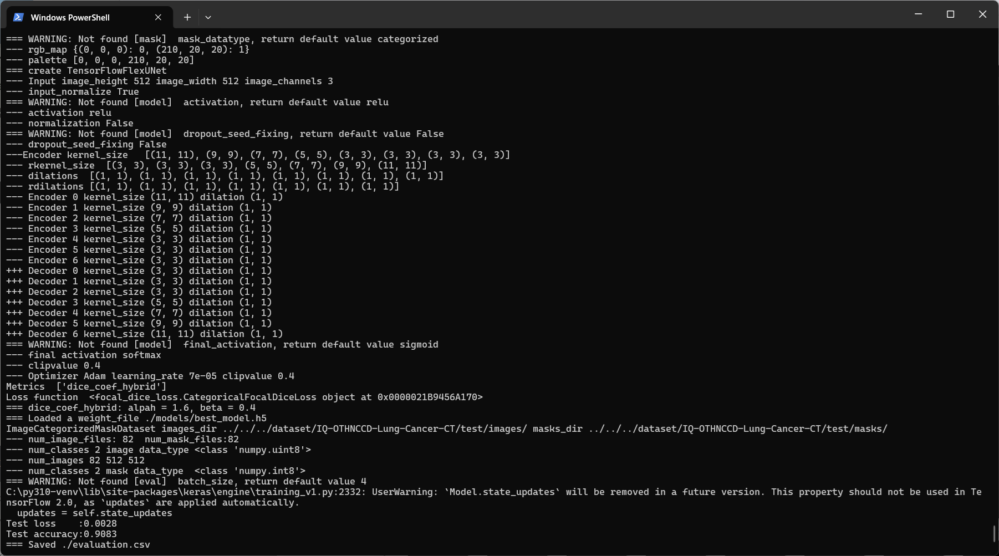
  Image-Segmentation-IQ-OTHNCCD-Lung-Cancer-CT

<a href="./projects/TensorFlowFlexUNet/IQ-OTHNCCD-Lung-Cancer-CT/evaluation.csv">evaluation.csv</a> 
The loss (categorical_focal_dice_loss) on this IQ-OTHNCCD-Lung-Cancer-CT/test was very low, but 
dice_coef_hybrid was not high, as shown below.
 
<pre>
categorical_focal_dice_loss,0.0028
dice_coef_hybrid,0.9083
</pre>
 
<h3>
5. Inference
</h3>
Please move to <b>./projects/TensorFlowFlexUNet/IQ-OTHNCCD-Lung-Cancer-CT</b> folder
and run the following bat file to infer segmentation regions for images using the trained TensorFlowUNet model for IQ-OTHNCCD-Lung-Cancer-CT. 
<pre>
>./3.infer.bat
</pre>
This runs the following command.
<pre>
>python ../../../src/TensorFlowFlexUNetInferencer.py ./train_eval_infer.config
</pre>

<b>mini_test_images</b> 
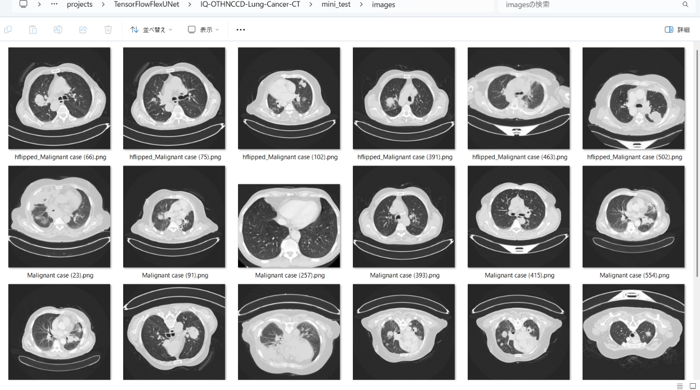 
<b>mini_test_mask(ground_truth)</b> 
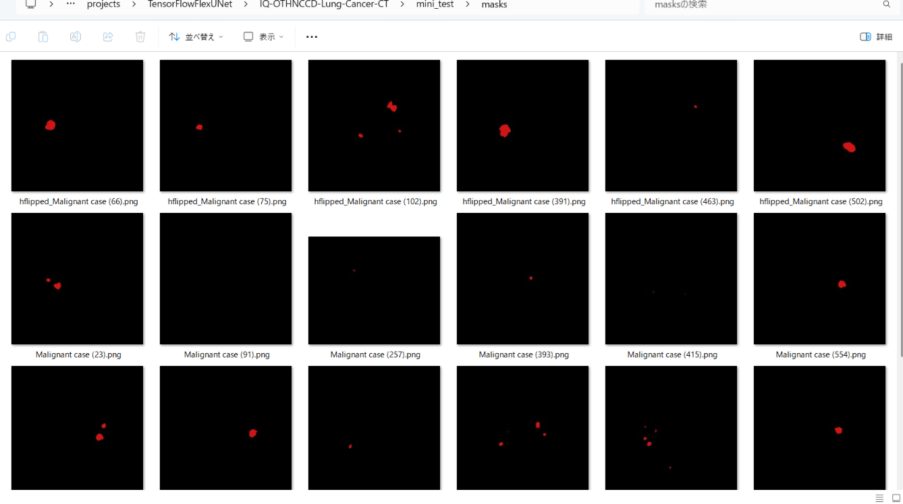 

<b>Inferred test masks</b> 
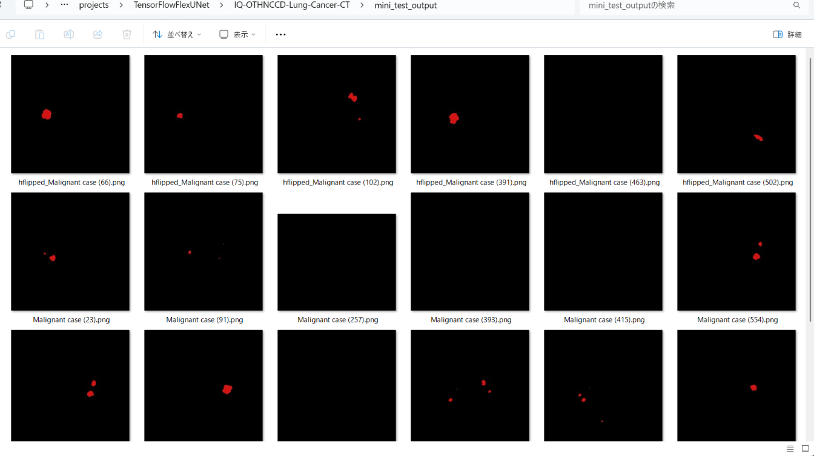 
 

<b>Enlarged images and masks for IQ-OTHNCCD-Lung-Cancer-CT Images of 512x512 pixels</b> 
As shown below, the inferred masks look similar to the ground truth masks except for the second and third cases. 
 
<table>
<tr>
<th width="320" height="auto">Image</th>
<th width="320" height="auto">Mask (ground_truth)</th>
<th width="320" height="auto">Inferred-mask</th>
</tr>
<tr>
<td></td>
<td></td>
<td></td>
</tr>
<tr>
<td></td>
<td></td>
<td></td>
</tr>
<tr>
<td></td>
<td></td>
<td></td>
</tr>
<tr>
<td></td>
<td></td>
<td></td>
</tr>
<tr>
<td></td>
<td></td>
<td></td>
</tr>
<tr>
<td></td>
<td></td>
<td></td>
</tr>
</table>

 
<h3>
References
</h3>
<b>1. Lung cancer segmentation dataset with Lung-RADS class</b> 
Nam, Diana; Panina, Alexandra; Pak, Alexandr  
(2024),  Mendeley Data, V1, doi: 10.17632/5rr22hgzwr.1  
<a href ="https://data.mendeley.com/datasets/5rr22hgzwr/1">
  https://data.mendeley.com/datasets/5rr22hgzwr/1
</a>
  
<b>2. Lung Tumor Image Segmentation from Computer Tomography Images Using MobileNetV2 and Transfer Learning</b> 
Zainab Riaz, Bangul Khan, Saad Abdullah, Samiullah Khan, Md Shohidul Islam 
<a href="https://pmc.ncbi.nlm.nih.gov/articles/PMC10451633/" >
  https://pmc.ncbi.nlm.nih.gov/articles/PMC10451633/
</a>
  
<b>3. NLSTseg: A Pixel-level Lung Cancer Dataset Based on NLST LDCT Images</b> 
Kun-Hui Chen, Yi-Hui Lin, Shawn Wu, Nai-Wen Shih, Hsing-Chen Meng, Yen-Yu Lin, Chun-Rong Huang & Jing-Wen Huang  
<a href ="https://www.nature.com/articles/s41597-025-05742-x">
https://www.nature.com/articles/s41597-025-05742-x
</a>
  
<b>4. TensorFlow-FlexUNet-Image-Segmentation-Smokers-Lung-Cancer-CT</b> 
Toshiyuki Arai 
<a href="https://github.com/sarah-antillia/TensorFlow-FlexUNet-Image-Segmentation-Smokers-Lung-Cancer-CT">
https://github.com/sarah-antillia/TensorFlow-FlexUNet-Image-Segmentation-Smokers-Lung-Cancer-CT
</a>
  
<b>5. TensorFlow-FlexUNet-Image-Segmentation-Lung-Cancer-CT</b> 
Toshiyuki Arai 
<a href="https://github.com/sarah-antillia/TensorFlow-FlexUNet-Image-Segmentation-Lung-Cancer-CT">
https://github.com/sarah-antillia/TensorFlow-FlexUNet-Image-Segmentation-Lung-Cancer-CT
</a>
  
<b>6. TensorFlow-FlexUNet-Image-Segmentation-Model</b> 
Toshiyuki Arai 
<a href="https://github.com/sarah-antillia/TensorFlow-FlexUNet-Image-Segmentation-Model">
https://github.com/sarah-antillia/TensorFlow-FlexUNet-Image-Segmentation-Model
</a>
  
